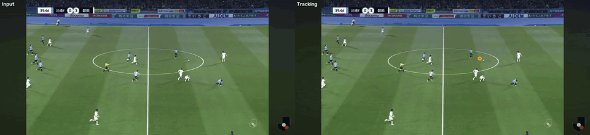
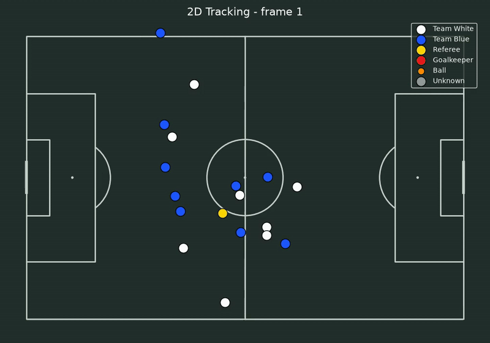

# サッカー映像のトラッキングとピッチの2D化

スマホで撮ったサッカーの試合映像から、選手・審判・ボールを追跡し、ピッチの位置合わせをして全選手を実寸（メートル）の2Dピッチに配置する。カメラがセンターサークルからゴール前へパンする映像でも、手動の点取りなしで位置合わせできる。

<p align="center">
  
</p>

<p align="center">
  
</p>

## 特徴

- **隠れても途切れにくい追跡**：YOLO11 + ByteTrack に加えて、途切れたトラックを「最後の速度でそのまま進んだ位置」から探してつなぎ直す（ハンガリアン法、チームの制約つき）。
- **チームはトラック単位で決める**：ユニフォームの色をトラック全体で集計（他の選手と重なったフレームは除外）するので、途中で色が変わらない。
- **ボールは経路として選ぶ**：全体・タイル分割・予測位置の切り出しの3通りの推論で候補を集め、動的計画法で最ももっともらしい軌道を選び、2次式（弾道）で欠けを埋める。ペナルティマークとセンターマークの誤検出はピッチ座標で除外する。
- **手動の点取りなしの位置合わせ**：SoccerNet-Calibration でフルスクラッチ学習した軽量 U-Net（MobileNetV3 + Coordinate Attention、4.07M パラメータ）で37個の目印を数フレームごとに検出し、間のフレームはカメラの動き（ORB）でつなぎ、白線と芝の縞で補正する。

## 結果

| 項目 | 指標 | 値 |
|---|---|---|
| キーポイント検出（SoccerNet-Calibration 検証用 1,629 枚） | PCK@5px（入力 640×352） | 0.891 |
| | ホモグラフィを作れる画像の割合（正しい点が5点以上） | 95.1% |
| | 画面外の目印を誤って検出した割合 | 0.3% |
| 位置合わせ（合成映像、センターサークルからゴール前へのパン、300 フレーム） | 地面上の誤差の中央値 | 0.17 m |
| トラックのつなぎ直し（合成、0.3〜2 秒の途切れ 17 箇所） | 正しいつなぎ / 誤ったつなぎ | 16 / 0 |

## セットアップ

```bash
sudo apt install -y ffmpeg
uv sync
uv run python -c "import torch; print(torch.cuda.is_available())"
```

動画は `data/` に置く（Windows 側の `/mnt/c` から直接読むと遅いので、Linux 側にコピーする）。

## 使い方

```bash
uv run python src/track.py video3.mov --slowdown 4 --kp-model models/pitch_kp/best.pt
uv run python src/visualize.py video3.mov
```

| 出力（`data/`） | 内容 |
|---|---|
| `<名前>_tracking.mp4` | チーム・審判・GK で色分けした箱とボールの軌跡を重ねた動画 |
| `<名前>_positions.csv` | フレームごとの位置（画像座標とピッチ座標[m]） |
| `<名前>_tracks.csv` | トラックごとのチームと、その決まり方 |
| `<名前>_homography.npz` | フレームごとの 画像→ピッチ のホモグラフィ |
| `<名前>_2d.mp4` | 2Dピッチ上の選手の動き |

- `--slowdown 4`：入力が 4 倍のスローの場合（iPhone のスロー撮影など）。時間に関する設定を実時間に合わせる。
- `src/track.py` 冒頭の `JERSEY_COLORS`：チーム・審判・GK のユニフォームの色（HSV の範囲）。
- 位置合わせの確認：`uv run python src/register.py video3.mov --kp-model models/pitch_kp/best.pt --debug-video` で、投影したピッチの白線を重ねた `<名前>_registration.mp4` が出る。
- モデルがない場合は `uv run python src/pick_keyframes.py video3.mov` で数フレームの目印を手でクリックする。

## キーポイント検出モデルの学習

```bash
cd src
uv run --with SoccerNet python -c "from SoccerNet.Downloader import SoccerNetDownloader as D; D(LocalDirectory='$HOME/data/soccernet').downloadDataTask(task='calibration-2023', split=['train','valid','test'])"
uv run python -m kp.convert_soccernet --soccernet ~/data/soccernet/calibration-2023 --out ~/data/sn_keypoints
uv run python -m kp.train --data ~/data/sn_keypoints --out ../models/pitch_kp --workers 4
```

SoccerNet-Calibration の注釈は白線上の点で、キーポイントそのものはない。`kp/convert_soccernet.py` は、白線の交点と白線そのものの対応から画像ごとにホモグラフィを求め（正規化 DLT）、交点が少ないセンター付近の画角ではサークルの中心と左右端を幾何学的に求め、全注釈点に当てはめ直してから37個の目印を投影する。メインカメラ以外の画角など、約半数の画像は除外される。

自分の映像で追加学習するときは、`kp/annotate.py` で位置合わせの結果を初期値にして点を直し、`kp/train.py --extra ... --init ...` で混ぜて学習する。

## 構成

```
src/
├── track.py              検出・追跡・つなぎ直し・チーム判定・ボールの経路・2D座標の出力
├── register.py           全フレームの位置合わせ
├── visualize.py          2Dピッチの描画
├── pitch.py              ピッチのモデル（メートル座標、目印と白線）
├── pick_keyframes.py     手動のキーフレーム指定（任意）
├── video_io.py           フレーム番号を正確にそろえる動画の読み込み
├── kp/                   ピッチのキーポイント検出
└── legacy/               以前の片側ゴールだけの位置合わせ
scripts/make_demo.py      README の GIF（docs/media）を作る
```

## 制約

- ボールは2Dに出さない。地面の平面へのホモグラフィでは浮いたボールの位置が出せず、映っていない区間も再現できないため。ボールはトラッキング動画で見る。
- ユニフォームの色は試合ごとに HSV の範囲で設定する。
- 選手の名前との対応付けはまだない（トラック ID は匿名）。
- スマホのスロー動画（.mov）は可変フレームレートなので、CSV の `time_s` は近似値。

## 謝辞

[Ultralytics YOLO](https://github.com/ultralytics/ultralytics)、[supervision](https://github.com/roboflow/supervision)、[trackers](https://github.com/roboflow/trackers)、[mplsoccer](https://github.com/andrewRowlinson/mplsoccer)、[SoccerNet](https://www.soccer-net.org/) の Camera Calibration データセットを使用した。SoccerNet で学習した重みはこのリポジトリでは配布しない（共有する場合は SoccerNet の利用条件を確認すること）。
