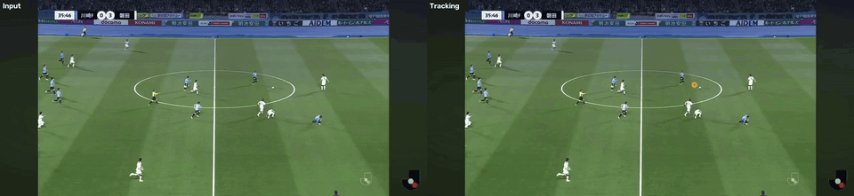
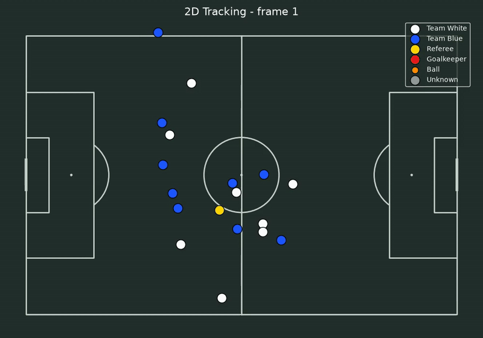
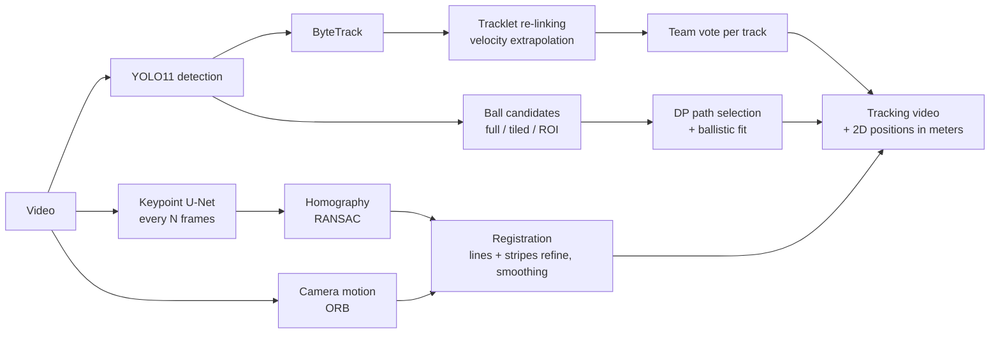

# Soccer Tracking & Pitch Registration

[](https://github.com/w4ter-fox/soccer-tracking/actions/workflows/ci.yml)

Player, referee and ball tracking for amateur soccer footage, with automatic pitch registration that maps every player onto a metric 2D pitch — even when the camera pans from the center circle to the goal.

<p align="center">
  
</p>

<p align="center">
  
</p>

> 日本語の説明は [README.ja.md](README.ja.md) を参照してください。

## Highlights

- **Tracking that survives occlusion** — YOLO11 + ByteTrack, then offline re-linking of broken tracklets by extrapolating each player's last velocity (Hungarian assignment, team-constrained).
- **Team assignment per track, not per frame** — jersey colors are voted over the whole track (ignoring occluded frames), so a player's color never flickers.
- **Ball tracking as a global path problem** — all candidates (full frame, tiled, and ROI re-detection) are collected, then a dynamic-programming search picks the most plausible trajectory; ballistic (quadratic) fits fill the gaps. Penalty and center spots are rejected in pitch coordinates.
- **Pitch registration without manual clicks** — a 4 M-parameter MobileNetV3 U-Net with Coordinate Attention, trained from scratch on SoccerNet-Calibration, detects 37 pitch landmarks every few frames. Camera motion (ORB) bridges the frames in between, and white lines plus grass mowing stripes refine the homography.

## Pipeline



## Results

| Component | Metric | Value |
|---|---|---|
| Pitch keypoint detector (SoccerNet-Calibration valid, 1,629 images) | PCK@5px (640×352 input) | 0.891 |
| | Images with ≥5 correct keypoints (homography possible) | 95.1% |
| | False detections of off-screen keypoints | 0.3% |
| Registration (synthetic pan from center circle to goal, 300 frames) | Median ground error | 0.17 m |
| Tracklet re-linking (synthetic, 17 breaks of 0.3–2 s) | Correct links / wrong links | 16 / 0 |

The detector is 4.07 M parameters and trains in about one hour on an RTX 3080 (80 epochs).

## Setup

Tested on Ubuntu (WSL2) with an RTX 3080.

```bash
sudo apt install -y ffmpeg
uv sync
uv run python -c "import torch; print(torch.cuda.is_available())"
```

Put videos in `data/` (copy them into the Linux filesystem; reading from `/mnt/c` is slow).

## Usage

Track players and the ball, register the pitch automatically, and export 2D positions:

```bash
uv run soccer-track video3.mov --slowdown 4 --kp-model models/pitch_kp/best.pt
uv run soccer-visualize video3.mov
```

Outputs in `data/`:

| File | Content |
|---|---|
| `<name>_tracking.mp4` | Input video with color-coded boxes (team, referee, goalkeeper) and the ball trail |
| `<name>_positions.csv` | Per-frame positions: image coordinates and pitch coordinates in meters |
| `<name>_tracks.csv` | Per-track team and how it was decided |
| `<name>_homography.npz` | Per-frame image-to-pitch homography |
| `<name>_2d.mp4` | Players on a 2D pitch |

Useful options:

- `--slowdown 4` — the input is slowed down 4× (e.g. iPhone slow motion). Time-based parameters are scaled accordingly.
- `src/soccer_tracking/config.py` — all tunable parameters (`Config`) and the jersey HSV ranges (`DEFAULT_JERSEY_COLORS`).
- `uv run soccer-register video3.mov --kp-model models/pitch_kp/best.pt --debug-video` — writes `<name>_registration.mp4` with the projected pitch lines, to check the registration.
- `uv run soccer-keyframes video3.mov` — click landmarks manually on a few frames if no model is available.

## Training the keypoint detector

```bash
uv run --with SoccerNet python -c "from SoccerNet.Downloader import SoccerNetDownloader as D; D(LocalDirectory='$HOME/data/soccernet').downloadDataTask(task='calibration-2023', split=['train','valid','test'])"
uv run python -m soccer_tracking.kp.convert_soccernet --soccernet ~/data/soccernet/calibration-2023 --out ~/data/sn_keypoints
uv run python -m soccer_tracking.kp.train --data ~/data/sn_keypoints --out models/pitch_kp --workers 4
```

SoccerNet-Calibration annotates line points, not keypoints. `kp/convert_soccernet.py` fits a homography per image from line intersections and line correspondences (normalized DLT), recovers center-circle landmarks geometrically when few intersections are visible, refines against every annotated point, and projects the 37 landmarks. About half of the images (non-main-camera views) are rejected.

To fine-tune on your own footage, `soccer_tracking.kp.annotate` pre-fills landmarks from the registration so you only correct them, and `soccer_tracking.kp.train --extra ... --init ...` mixes them into training.

## Project structure

```
src/soccer_tracking/
├── track.py          pipeline: detection → tracking → re-linking → teams → ball → outputs (CLI: soccer-track)
├── registration.py   per-frame pitch registration (CLI: soccer-register)
├── visualize.py      2D pitch rendering (CLI: soccer-visualize)
├── keyframes.py      manual keyframes, optional (CLI: soccer-keyframes)
├── config.py         all tunable parameters and class IDs
├── ball.py           ball candidates, DP path selection, ballistic fit
├── linking.py        tracklet re-linking by velocity extrapolation
├── teams.py          per-track team decision
├── jersey.py         jersey color classification
├── vision.py         pitch mask, white lines, camera motion, scene cuts
├── video_io.py       frame-accurate reader and H.264 writer
├── pitch.py          pitch model in meters (landmarks and lines)
└── kp/               pitch keypoint detector (convert, model, dataset, train, detect, annotate)
tests/                pytest suite (CPU only; runs in GitHub Actions)
scripts/make_demo.py  builds the GIFs in docs/media
```

## Development

```bash
uv sync --group dev
uv run pytest
uv run ruff check src tests scripts
```

The tests use synthetic data (rendered pitch lines, simulated runners and ball trajectories, SoccerNet-style line annotations), so they run without a GPU or video files.

## Limitations

- The ball is not shown on the 2D pitch: a ground-plane homography cannot place an airborne ball, and frames where the ball is not seen cannot be reconstructed. The ball is shown in the tracking video instead.
- Jersey colors are configured with HSV ranges per match.
- Player identities (names) are not assigned yet; track IDs are anonymous.
- Slow-motion `.mov` files from phones are variable frame rate, so `time_s` in the CSV is approximate.

## Acknowledgements

[Ultralytics YOLO](https://github.com/ultralytics/ultralytics), [supervision](https://github.com/roboflow/supervision), [trackers](https://github.com/roboflow/trackers), [mplsoccer](https://github.com/andrewRowlinson/mplsoccer), and the [SoccerNet](https://www.soccer-net.org/) Camera Calibration dataset. Model weights trained on SoccerNet are not distributed in this repository; check the SoccerNet terms before sharing them.

This project was developed with assistance from Claude (Anthropic) for code generation, debugging and documentation. Design decisions, experiments on real footage and model training were carried out by the author.